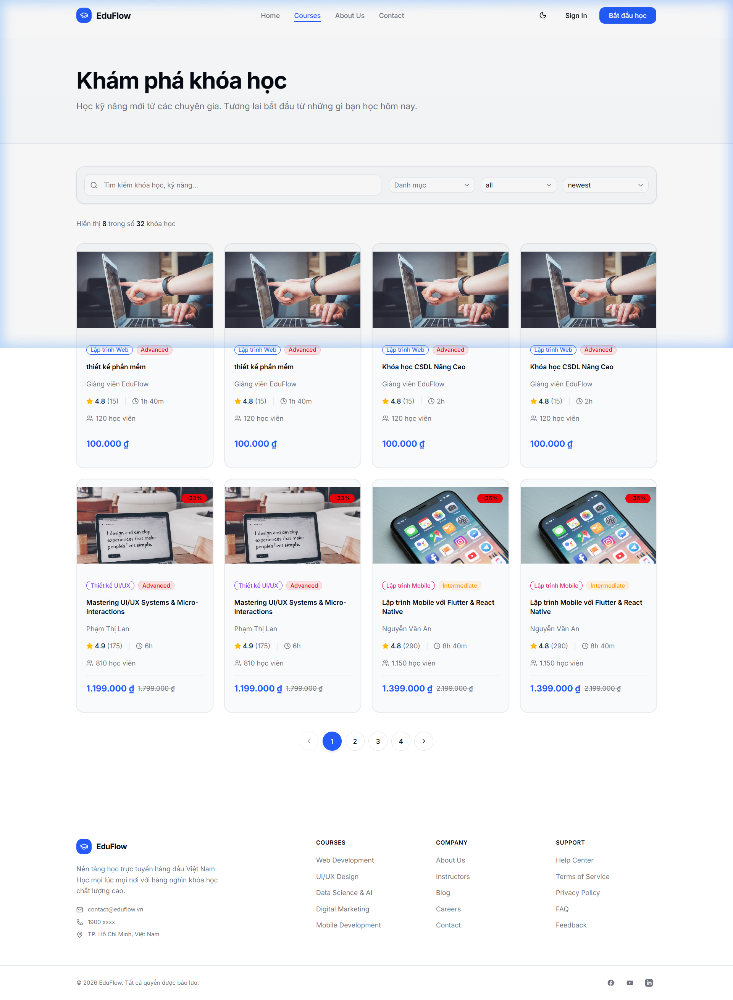
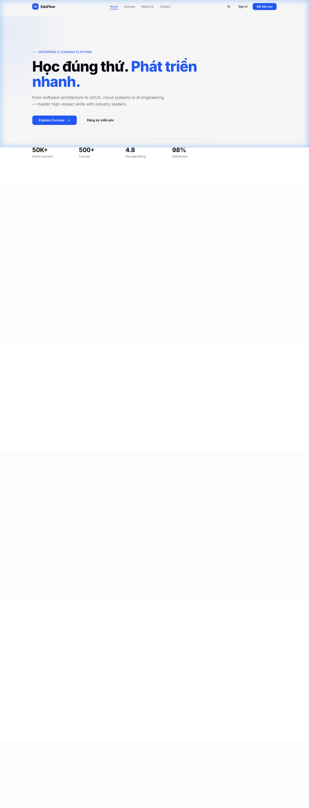

# 🎓 EduFlow — Enterprise Online Learning & Course Management Platform

<p align="center">
  
  
  
  
  
  
  
</p>

<p align="center">
  A production-grade, full-stack Learning Management System (LMS) engineered with Next.js App Router, Strapi Headless CMS, and Firebase, developed by <strong>Đặng Đại Lợi (<a href="https://github.com/ddloi">@ddloi</a>)</strong>.
</p>

---

## 📸 Application Showcase & Screenshots

### 1. Course Discovery Catalog
<p align="center">
  
  <br/>
  <em>Figure 1: Course Catalog — Category taxonomy filters, sorting, instructor badges, ratings, student counts, and pricing tiers.</em>
</p>

### 2. Modern Hero Landing Page
<p align="center">
  
  <br/>
  <em>Figure 2: Homepage Hero — Modern design system, value proposition, and key learning statistics.</em>
</p>

---

## 🌟 Key Features

### 🎓 Student Experience
- **Modern Course Discovery:** Filter and search courses by category, difficulty level, and rating.
- **Interactive Learning Environment:** Structured lesson playback with video player, lesson transcripts, downloadable resources, and lesson completion checkmarks.
- **Quizzes & Assessments:** Multi-question timed quizzes with instant grading, score review, and retake policies.
- **Certificates of Completion:** Automated certificate generation upon 100% course completion.
- **Gamified Leaderboard:** Points and ranking system based on completed lessons, quiz achievements, and learning streaks.
- **Student Dashboard:** Track enrolled courses, active progress percentages, hours spent, and certificates earned.

### 👨‍🏫 Instructor Workspace
- **Course Studio:** Create, edit, and organize courses with modules, chapters, and rich media lessons.
- **Student Analytics:** Real-time visibility into enrollments, completion rates, and average quiz scores using interactive Recharts.
- **Q&A & Discussion Management:** Answer student questions, moderate comments, and engage with learners.

### 🛡️ Administrator Portal
- **Platform Overview:** High-level metrics on total active users, courses published, revenue trends, and platform engagement.
- **User Governance:** Manage student and instructor accounts, role assignments, and permissions.
- **Course Moderation:** Review submitted courses before public publication.

---

## 🏗️ System Architecture

```text
                               ┌────────────────────────┐
                               │   Next.js App Router   │
                               │   (Frontend & BFF)     │
                               └──────────┬─────────────┘
                                          │
                  ┌───────────────────────┴───────────────────────┐
                  ▼                                               ▼
     ┌────────────────────────┐                      ┌────────────────────────┐
     │   Strapi Headless CMS  │                      │   Firebase Ecosystem   │
     ├────────────────────────┤                      ├────────────────────────┤
     │ • Course Catalog       │                      │ • User Authentication  │
     │ • Curriculum Modules   │                      │ • Progress Data Store  │
     │ • Lessons & Media      │                      │ • Certificate Records  │
     │ • Category Taxonomy    │                      │ • Real-time Sync       │
     └────────────────────────┘                      └────────────────────────┘
```

---

## 🛠️ Tech Stack & Tooling

- **Core Framework:** Next.js 16 (Turbopack, App Router, Server Components & Server Actions), React 19, TypeScript 5
- **Styling:** Tailwind CSS v4, Radix / Base UI Primitives, Lucide Icons, tw-animate-css
- **State Management & Caching:** TanStack React Query v5, Zustand v5
- **Backend & CMS:** Strapi Headless CMS (REST API with qs query filters)
- **Identity & Data Sync:** Firebase Authentication & Cloud Firestore
- **Data Visualization:** Recharts
- **Emails:** Nodemailer (SMTP transactional order & progress updates)
- **Deployment:** Vercel (Edge-optimized Next.js deployment)

---

## 🚀 Getting Started

### Prerequisites
- Node.js `>= 20.x`
- npm or pnpm
- (Optional) Strapi CMS instance running locally or on cloud

### 1. Clone & Install Dependencies
```bash
git clone https://github.com/ddloi/elearning-platform.git
cd elearning-platform
npm install
```

### 2. Environment Configuration
Copy `.env.example` to `.env.local` and populate your credentials:
```bash
cp .env.example .env.local
```

### 3. Launch Development Server
```bash
npm run dev
```
Open **[http://localhost:3000](http://localhost:3000)** in your browser.

---

## 👨‍💻 Author & Contact

- **Developer:** Đặng Đại Lợi
- **GitHub:** [@ddloi](https://github.com/ddloi)
- **Email:** [dangdailoi732006@gmail.com](mailto:dangdailoi732006@gmail.com)
- **LinkedIn:** [ddloi](https://www.linkedin.com/in/ddloi)
- **Institution:** HUFLIT (Ho Chi Minh City University of Foreign Languages & Information Technology)